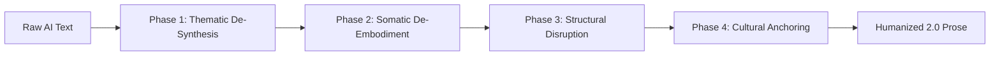

# Humanizer 2.0: Structural Anti-Slop & Discourse Engineering

[](./SKILL.md)
[](#the-storyscope-discovery)
[](./LICENSE)
[](https://www.python.org/)
[](./.github/workflows/audit.yml)

> **A universal, cross-agent skill and diagnostic engine that eliminates synthetic AI writing slop by engineering narrative structure, discourse choices, and temporal pacing rather than swapping surface vocabulary.**

Compatible with **Google Antigravity**, **Claude Code**, **Cursor**, **Windsurf**, **OpenHands**, **Cline**, **GitHub Copilot**, and **ChatGPT / Custom GPTs**.

---

## Table of Contents

- [The Paradigm Shift: Why Humanizer 1.0 Failed](#the-paradigm-shift-why-humanizer-10-failed)
- [The 3 Pillars of AI Slop](#the-3-pillars-of-ai-slop)
- [The 4-Phase Transformation Pipeline](#the-4-phase-transformation-pipeline)
- [Quick Start: Universal Agent Installation](#quick-start-universal-agent-installation)
  - [Google Antigravity & Agent Skills](#1-google-antigravity--agent-skills)
  - [Claude Code & Anthropic Workflows](#2-claude-code--anthropic-workflows)
  - [Cursor & Windsurf IDEs](#3-cursor--windsurf-ides)
  - [ChatGPT / Custom GPTs / Claude Web](#4-chatgpt--custom-gpts--claude-web)
- [StoryScope Narrative Auditor (CLI)](#storyscope-narrative-auditor-cli)
- [Documentation & Deep Dives](#documentation--deep-dives)
- [Repository Structure](#repository-structure)
- [Academic Citation](#academic-citation)
- [License](#license)

---

## The Paradigm Shift: Why Humanizer 1.0 Failed

Traditional "AI Humanizers" perform superficial cosmetic edits:
* Swapping telltale buzzwords (*delve*, *tapestry*, *testament*, *beacon*, *unfurl*).
* Removing semicolons or em-dashes.
* Randomizing sentence length or injecting artificial typos.

### The 93.9% Detectability Trap
In the empirical benchmark ***StoryScope: Investigating idiosyncrasies in AI fiction*** (Russell et al., COLM 2026), researchers evaluated 61,608 stories across 10 NarraBench dimensions and 304 narrative features.

When AI stories underwent rigorous span-level cosmetic rewrite by professional human editors:
* Detection dropped by only **1.6%** (from **95.5%** to **93.9% F1**).
* Even with **100% of surface lexical cues erased**, classifiers trained solely on **narrative and discourse structure** reliably identified synthetic writing with **93.2% Macro-F1**.

> **Key Takeaway**: Synthetic text is exposed not by *what words are chosen*, but by *how the narrative is constructed*. Humanizer 2.0 fixes the architectural discourse layer.

---

## The 3 Pillars of AI Slop

StoryScope isolates three systematic discourse failure modes where LLMs consistently deviate from human authors:

```
┌─────────────────────────────────────────────────────────────────────────────┐
│                           THE 3 AI SLOP SYNDROMES                           │
├─────────────────────────┬─────────────────────────┬─────────────────────────┤
│  1. THEMATIC OVER-      │  2. SENSORY & EMBODIED  │  3. CAUSAL HYPER-       │
│     DETERMINATION       │     PERFORMATIVITY      │     LINEARITY           │
├─────────────────────────┼─────────────────────────┼─────────────────────────┤
│ • Narrator sermonizing  │ • Visceral cliché reflex│ • Single-track conveyor │
│   moral wrap-ups        │   (throat tight, chest  │   belt from A to Z      │
│   (77% AI vs 52% Human) │   tight, breath caught) │ • 79% AI stories have   │
│ • Dialogue turned into  │ • Embodied emotion:     │   NO subplots (vs 57%)  │
│   philosophical debate  │   81% AI vs 38% Human   │ • Protagonist solves all│
│   (59% AI vs 34% Human) │ • Compulsive olfactory  │   by neat agency / inner│
│ • Compulsive thematic   │   smell tags (82% vs 57%)│  acceptance (47% vs 27%)│
│   closure with no loose │ • Pathetic fallacy:     │ • Strict linear clock;  │
│   intellectual ends     │   setting mirrors mood  │   no real anachrony     │
└─────────────────────────┴─────────────────────────┴─────────────────────────┘
```

---

## The 4-Phase Transformation Pipeline



### 1. Thematic De-Synthesis (Kill the Epilogue)
- **Delete Moralizing Conclusions**: Erase closing paragraphs where the narrator reflects on what was "truly learned" or declares a "quiet peace settled over".
- **De-philosophize Dialogue**: Characters speak to accomplish logistical tasks, defend egos, make mistakes, or avoid uncomfortable truths—not to defend philosophical theses.
- **Retain Ambiguity**: Human writing has a 59% rate of moral ambivalence in protagonist actions (vs. 38% for AI). Resist clean justifications.

### 2. Somatic De-Embodiment (Stop Over-Writing the Flesh)
- **Abolish Autonomic Spasms**: Strip involuntary somatic clichés (*throat tightened*, *heart hammered*, *cold sweat*, *breath caught*, *stomach knotted*).
- **Restore Explicit Emotion Naming**: Human authors use direct labels (*she was terrified*, *he felt exhausted*) 29% of the time vs. 8% for AI. 
- **Prune Olfactory Obsession**: Eliminate compulsive smell descriptors (*ozone, damp earth, metallic copper*).
- **Decouple Setting from Psychology**: Dismantle pathetic fallacy. Environments should be indifferent, mundane, or ironically mismatched to character emotions.

### 3. Structural & Temporal Disruption (Break the Conveyor Belt)
- **Inject Asymmetric Subplots**: Add parallel or contrasting conflicts that do not neatly echo the main theme (42% human prevalence vs. 21% AI).
- **Introduce Chronological Anachrony**: Use flashbacks, ellipses, and retrospective disclosures (+0.28 statistical gap in human writing).
- **Decouple Climax from Pure Agency**: Real resolutions often hinge on institutional friction, external chance, or third-party interference (only 46% of human resolutions are pure protagonist agency, vs. 69% for AI).

### 4. Cultural Anchoring & Voice Posture (Enter the Real World)
- **Ground in Named Entities**: Use real brands, specific streets, historical dates, and technical details rather than vague universal archetypes (47% human vs. 24% AI).
- **Direct Reader Engagement**: Cultivate authorial perspective and fourth-wall awareness (0.67 human permeability vs. 0.39 AI).

---

## Quick Start: Universal Agent Installation

This repository adheres to the **Universal Agent Skills Standard** (`SKILL.md`), making it instantly discoverable by modern agent platforms.

### Automated Installation (One Command)
Clone the repository and run the installer:
```bash
git clone https://github.com/your-username/humanizer-skill.git
cd humanizer-skill
./install.sh auto
```

Or install for your specific environment:

### 1. Google Antigravity & Agent Skills
* **Global installation**:
  ```bash
  ./install.sh antigravity-global
  # Installed into ~/.gemini/antigravity/skills/humanizer
  ```
* **Project-local**:
  ```bash
  ./install.sh antigravity-local
  # Installed into ./.agents/skills/humanizer
  ```

### 2. Claude Code & Anthropic Workflows
Copy the skill into Claude's skill discovery path or reference the configuration in `integrations/CLAUDE.md`:
```bash
./install.sh claude-global
# or
./install.sh claude-local
```

### 3. Cursor & Windsurf IDEs
Append the anti-slop rules directly to your project's `.cursorrules`:
```bash
./install.sh cursor
```
Alternatively, copy [integrations/.cursorrules](./integrations/.cursorrules) to your project root.

### 4. ChatGPT / Custom GPTs / Claude Web
Copy the ready-to-use prompt from [integrations/system_prompt.md](./integrations/system_prompt.md) directly into your Custom GPT's **Instructions** or Claude Project **System Instructions**.

---

## StoryScope Narrative Auditor (CLI)

This repository includes a standalone Python CLI that audits any draft against the 30 core StoryScope features and calculates an objective **AI Slop Score (0–100%)**.

### Run Without Installation
```bash
python3 scripts/audit_narrative.py examples/sample_narratives/raw_ai_story.txt
```

### Sample Output (Raw AI Draft: 95.0% Slop Risk)
```text
======================================================================
 STORYSCOPE NARRATIVE SLOP AUDIT REPORT (HUMANIZER 2.0)
======================================================================
 Analyzed Words:      185
 Paragraphs:          6
----------------------------------------------------------------------
 AI Slop Score:       95.0%
 Assessment:          CRITICAL RISK: HIGH SYNTHETIC AI SLOP PROFILE
 Recommendation:      Reject / Full structural rewrite required.
======================================================================

DETAILED FEATURE BREAKDOWN:

[1] Thematic Over-determination & Moralizing: 1 flagged
    - Flag: 'In that moment, she understood' in '...understood what it truly meant...'
    -> Action: Delete the moralizing conclusion. End on a concrete action.

[2] Somatic / Bodily Cliché Reflexes: 6 flagged
    - Flag: 'throat tightened' in '...Her throat tightened as a cold sweat broke out...'
    - Flag: 'heart hammered' in '...Her heart hammered against her ribs...'
    - Flag: 'knot of dread' in '...A knot of dread formed in the pit of her stomach...'
    -> Action: De-embody emotions. Replace with direct labels or situational reactions.

[3] Explicit Emotion Labels: 0 found
    -> Advisory: Zero explicit emotion labels found.

[4] Olfactory / Smell Imagery: 4 flagged
    - Flag: 'smell of', 'ozone', 'metallic tang'
    -> Action: Prune artificial scent markers.

[5] Setting as Psychological Mirror (Pathetic Fallacy): 1 flagged
    - Flag: 'mirroring the deep sorrow' in '...rain weep against the glass...'
    -> Action: Decouple setting from character mood.
======================================================================
```

### Run Against Humanized Prose (0.0% Slop Score)
```bash
python3 scripts/audit_narrative.py examples/sample_narratives/humanized_story.txt
```
```text
======================================================================
 AI Slop Score:       0.0%
 Assessment:          LOW RISK: DIVERSE HUMAN-LIKE NARRATIVE DISCOURSE
 Recommendation:      Passes narrative discourse criteria.
======================================================================
```

### Pip Installation
You can also install the CLI as a system command:
```bash
pip install .
humanizer-audit path/to/story.txt
```

---

## Documentation & Deep Dives

| Document | Description |
| :--- | :--- |
| **[SKILL.md](./SKILL.md)** | Root universal skill prompt loaded by AI agents |
| **[Core Features Matrix](./references/core_features_matrix.md)** | Full statistical breakdown, SHAP importance, and distribution gaps for all 30 features |
| **[Model Fingerprints Guide](./references/model_fingerprints.md)** | Tailored countermeasures for Claude, GPT, Gemini, DeepSeek, and Kimi |
| **[AI Slop Syndromes & Antidotes](./references/slop_syndromes.md)** | In-depth pathology of thematic over-determination and somatic clichés |
| **[Transformation Playbook](./references/transformation_playbook.md)** | Step-by-step structural engineering rewrite templates |
| **[Comparative Case Study](./examples/before_after_case_study.md)** | Side-by-side progression: Raw AI vs Humanizer 1.0 vs Humanizer 2.0 |

---

## Repository Structure

```
humanizer-skill/
├── .agents/skills/humanizer/
│   └── SKILL.md              # Nested Agent Skills standard entrypoint
├── .github/workflows/
│   └── audit.yml             # GitHub Actions CI workflow
├── integrations/
│   ├── CLAUDE.md             # Claude Code / Anthropic Projects setup
│   ├── .cursorrules          # Cursor IDE rules file
│   └── system_prompt.md      # Copy-paste system prompt for ChatGPT / Claude
├── references/
│   ├── core_features_matrix.md
│   ├── model_fingerprints.md
│   ├── narrative_dimensions.md
│   ├── slop_syndromes.md
│   └── transformation_playbook.md
├── examples/
│   ├── before_after_case_study.md
│   └── sample_narratives/
│       ├── raw_ai_story.txt
│       └── humanized_story.txt
├── scripts/
│   └── audit_narrative.py    # StoryScope CLI diagnostic tool
├── tests/
│   └── test_audit.py         # Unit tests for audit engine
├── install.sh                # Cross-agent shell installer
├── pyproject.toml            # Python packaging specification
├── requirements.txt          # Python requirements
├── LICENSE                   # MIT License
├── SKILL.md                  # Universal root agent skill definition
└── README.md                 # Primary project documentation
```

---

## Academic Citation

If you use Humanizer 2.0 in research or production, please cite the foundational research paper:

```bibtex
@inproceedings{russell2026storyscope,
  title     = {StoryScope: Investigating idiosyncrasies in AI fiction},
  author    = {Russell, et al.},
  booktitle = {Proceedings of the 3rd Conference on Language Modeling (COLM 2026)},
  year      = {2026}
}
```

---

## License

This project is licensed under the [MIT License](./LICENSE). Feel free to adapt, extend, and integrate into any AI agent framework or creative writing pipeline.
